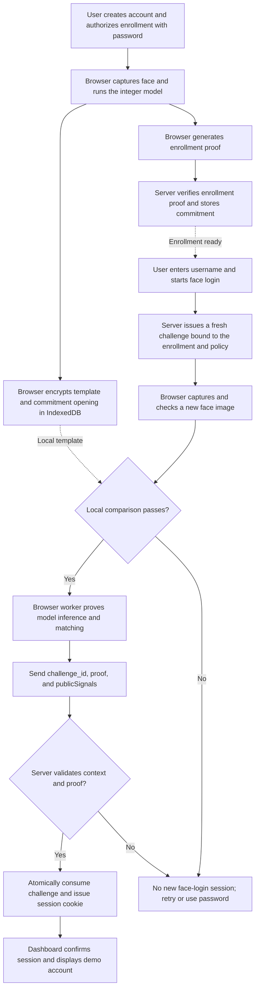
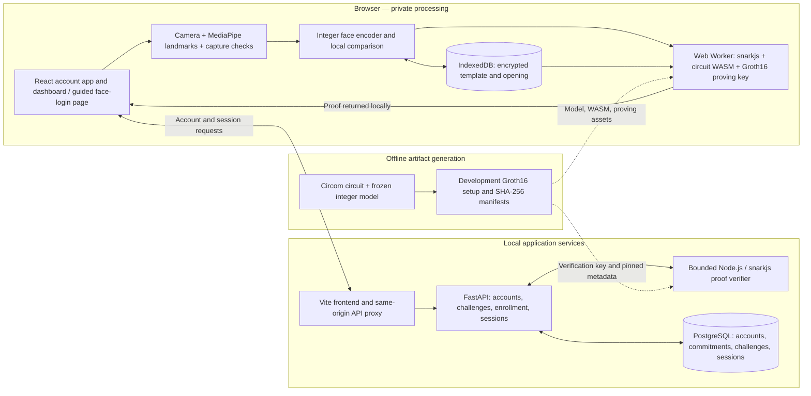

# PrivFace

Browser-based face authentication with zero-knowledge proofs and password fallback.

[What it is](#1-what-the-project-is) · [Run locally](#2-how-to-run-it) · [Information flow](#3-information-flow) · [Architecture](#4-architecture)

## 1. What the project is

PrivFace is a research prototype that lets an enrolled user sign in with a face capture while keeping the image and numerical face template in the browser. The browser runs a compact integer recognition model and generates a **Groth16 zero-knowledge proof**. The server verifies the proof against the registered enrollment and a fresh challenge before creating an authenticated session.

The current demonstration includes:

- Password-authorized face enrollment and encrypted template storage in IndexedDB.
- Camera positioning, image-quality feedback, and experimental movement checks.
- Local face matching and proof generation in a browser worker.
- Server-side proof verification, single-use challenges, and HTTP-only session cookies.
- Password fallback, sign-out, recovery codes, and enrollment management.
- A dashboard welcoming the authenticated user, with **fictional** banking balances and transactions.

**Scope:** this is a localhost research demonstration, not production banking software or a certified biometric system. Recognition can reject genuine users. A valid proof establishes the specified computation and match; it does not establish that the pixels came from a live person or a trusted camera. Movement checks and the single-party development trusted setup are not production security assurances.

The repository also retains an earlier face-api.js / descriptor-comparison experiment. Its templates are **not interchangeable** with the full-inference face-login flow described below.

## 2. How to run it

### Prerequisites

- **Node.js 22.12+** and npm; Node.js 24 is used in the current development environment.
- **Python 3.12** with `venv` and pip.
- A camera-enabled browser; Chrome on macOS is the tested demo environment.
- Internet access for the initial dependency installation.

The commands below use a macOS/Linux-style shell. The launcher uses an embedded PostgreSQL package, so a separate PostgreSQL installation is not required. Physical phone authentication and Windows setup have not been validated by this guide.

### Install dependencies

```bash
git clone https://github.com/Crispy2225/privface.git
cd privface

npm ci --prefix client
npm ci --prefix tools
npm ci --prefix zk

python3.12 -m venv server/.venv
server/.venv/bin/python -m pip install -r server/requirements.txt
```

The frozen demo model and camera-model files are checked in. Training a model or collecting a dataset is not required to run the demo.

### Prepare proof artifacts — first setup only

Large generated proving artifacts are excluded from Git. Generate both the earlier descriptor-proof artifacts used by the account app and the full-inference artifacts used by face login:

```bash
npm --prefix zk run setup
ZKML_PTAU="$PWD/zk/artifacts/final.ptau" npm --prefix zk run setup:ml
```

These commands compile the circuits, create development proving/verification keys, and prepare the full-inference browser assets. They can take time on the first run. The second command reuses and verifies the first command’s development powers-of-tau file.

**Skip setup for artifact sets that already exist.** The scripts deliberately refuse to overwrite an existing manifest. Do not regenerate keys or replace the model while rehearsing with an enrolled account: changing the setup/model requires re-enrollment. These are development artifacts, not a production trusted setup.

### Start the application

```bash
node tools/dev.mjs
```

The launcher starts persistent local PostgreSQL, applies migrations, prepares camera/browser assets, and starts the API and frontend.

| Page | URL | Purpose |
| --- | --- | --- |
| Account | http://localhost:5173/ | Registration, password access, and account settings |
| Face login | http://localhost:5173/face-login.html | Face enrollment, face login, and password fallback |
| Dashboard | http://localhost:5173/dashboard | Session-checked dashboard with fictional data |
| Proof lab | http://localhost:5173/zkml.html | Separate full-inference proof experiment |
| Calibration | http://localhost:5173/study | Consented sample collection for the earlier descriptor experiment |

Use **the same browser profile and exact origin** throughout enrollment and login. `localhost` and `127.0.0.1` have different browser storage. The face-proof demo is explicitly restricted to localhost; exposing the frontend over HTTPS does not enable remote phone face authentication.

### Try the complete demonstration

1. Open the account page, choose **Register**, and create a username/password account. The account exists once registration succeeds; you can leave the older camera setup on that page.
2. Open **Face login → Set up face**. Enter the same username and password.
3. Choose **Start camera**, follow the movement prompts, and select **Capture face → Save face enrollment**. Wait for server-confirmed enrollment.
4. Choose **Sign out & try again**. In **Face login** mode, enter the username only; no password is required.
5. Take a fresh capture and choose **Verify & sign in**.
6. After **Face proof accepted**, choose **Continue to dashboard**. The welcome name and authentication method come from the server session; all banking data is illustrative.

Use **Use password** if recognition fails. Keep the capture page visible: hiding it clears temporary camera data and cancels local work. Captures expire after one minute.

Face setup is browser-specific. Enrolling another browser replaces the account’s active binding. Keep the working enrollment unchanged when measuring repeat-login performance.

### Stop and resume

Press **Ctrl+C** in the launcher terminal to stop the services. Run `node tools/dev.mjs` again to resume.

- Account data persists under the ignored `data/` directory.
- Encrypted enrollment persists in browser storage unless that storage is cleared or removed. Avoid private/incognito mode for persistent enrollment.
- Temporary camera images are not saved as a dataset.
- Calibration-page samples are held in page memory: choose **Export sensitive dataset** before refreshing or closing that page.

### Run checks

From the repository root:

```bash
npm --prefix client test
npm --prefix client run build
npm --prefix zk run test:ml

server/.venv/bin/python -m pip install -r server/requirements-dev.txt
node tools/test-postgres.mjs
```

The PostgreSQL test launcher creates a **separate disposable database**. Never point `TEST_DATABASE_URL` at application data: test fixtures create and drop tables.

Browser checks require Playwright and a compatible Chrome/Chromium installation, plus a running frontend:

```bash
npm --prefix client run test:face-camera
npm --prefix client run test:dashboard
```

If Playwright is not resolvable from the project, set `PLAYWRIGHT_MODULE` to its installed module path. Set `CHROME_PATH` when using an existing Chrome executable, and `M4_TEST_ORIGIN` to change the default `http://localhost:5173` origin. Browser UI tests use generated video and mocked authentication responses; real proof/API tests run separately. These checks do not measure biometric accuracy.

## 3. Information flow

Enrollment first establishes the account’s authorized commitment. Login then proves a fresh capture matches that enrollment.



### What crosses the network?

| Stays in the browser | Sent to / handled by the server |
| --- | --- |
| Captured image and cropped pixels | Username and account metadata |
| Enrolled and newly inferred face embeddings | Password during registration, enrollment authorization, or fallback; stored as a salted hash |
| Template encryption key and commitment opening | Enrollment commitment and version/model/policy context |
| Private proof witness and intermediate inference values | Challenge identifier, proof, and public signals |
| Encrypted template in IndexedDB | Session cookies and account-management requests |

The implemented face-login requests do **not** upload images, pixel arrays, embeddings, or commitment openings. The server checks the cryptographic relation rather than performing image comparison itself. Fresh challenges prevent reuse of an old proof; they do not by themselves prevent a new proof being generated from reused or spoofed image input.

## 4. Architecture



### Components

| Component | Technology / responsibility | Location |
| --- | --- | --- |
| Account app and dashboard | React, TypeScript, Vite; session-based UI and fictional dashboard | [`client/src/`](client/src/) |
| Guided face-login UI | Login/setup modes, encrypted storage, local match diagnostics, proof submission | [`client/face-login.html`](client/face-login.html), [`client/public/zkml/face-login.mjs`](client/public/zkml/face-login.mjs) |
| Camera processing | MediaPipe landmarks, movement checks, face crop and quality feedback | [`client/src/face-login-camera.ts`](client/src/face-login-camera.ts) |
| Recognition and proving | 32×32 grayscale input → 32 hidden units → 16-value embedding; integer inference and Groth16 worker | [`client/public/zkml/`](client/public/zkml/) |
| Proof circuit | Constrains inference, template commitment, match threshold, and public context | [`zk/circuits/zkml.circom`](zk/circuits/zkml.circom) |
| Backend | FastAPI, SQLAlchemy; authorized enrollment, challenge consumption, verification and sessions | [`server/app/face_login.py`](server/app/face_login.py), [`server/app/main.py`](server/app/main.py) |
| Persistence | PostgreSQL schema and Alembic migrations | [`server/app/database.py`](server/app/database.py), [`server/migrations/`](server/migrations/) |
| Local tooling | Persistent development stack and disposable PostgreSQL tests | [`tools/`](tools/) |

The server accepts login only after verifying the proof against trusted challenge state and rechecking the active enrollment. The dashboard queries `/api/session` before rendering the signed-in view; its sample balances are static demo content, not financial records.

Further detail: [face-login protocol](docs/M4-FACE-LOGIN.md), [proof circuit and verification](docs/M3-ZKML.md), [frozen demo model and measurements](docs/M3-REFINED-DEMO.md), and [model evaluation limitations](docs/M2-VERIFICATION.md). Milestone documents preserve historical results; this README describes the current demonstration flow.
