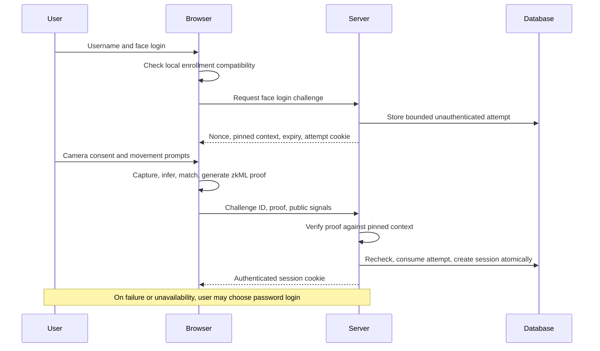

# M1 Face first authentication specification

Status: M1 specification complete. The M2/M3 research implementation is now documented in [M2](M2-MODEL-FEASIBILITY.md) and [M3](M3-ZKML.md); acceptable biometric accuracy and M4 login integration remain open. The baseline/evidence table below records the M1 starting point.
Updated: 1 November 2026.

PrivFace will use face verification as the primary login route. A successful server-verified face proof creates an authenticated session without a prior password session. Password login is the fallback when recognition fails or face verification cannot run. Both routes grant normal account access; this is an alternative-factor design, not mandatory two-factor authentication.

This document governs future development. [PASSWORD-REGISTRATION.md](PASSWORD-REGISTRATION.md) describes the currently running password-first app. [M1-BASELINE.md](M1-BASELINE.md) records verified baseline behavior. No runtime authentication behavior changes in M1.

## 1 Scope and decisions

| Decision | M1 specification |
| --- | --- |
| Account selection | Username first, followed by one-to-one verification against that account's enrollment. No face search or identification across accounts. |
| Primary login | Username, local face capture, local inference/proving, remote proof verification, then session issuance. No password is required on the successful face route. |
| Fallback | Explicit **Use password instead** after mismatch, capture failure/cancellation, missing enrollment, unsupported device, or proof failure. It does not automatically log the user in. |
| Enrollment | Register with username/password, consent, capture locally, then bind an authorized commitment. Registration may succeed even if camera setup fails. |
| Account security | Replacement/revocation of enrollment and recovery/security actions require fresh password confirmation, even in a face-authenticated session. |
| Initial device scope | One active enrollment binding per account, stored locally in one browser profile/origin. No biometric synchronization. Enrolling a new browser replaces the active binding and invalidates the old one. |
| Password storage | Preserve the current salted scrypt implementation. Never save the password in browser storage or reuse it silently after a failed face attempt. |
| Proof scope | Prove approved recognition inference plus matching against an authorized committed template. Never promote the existing descriptor-only proof into a login credential. |
| Capture scope | Browser movement checks are heuristic. Unattested camera input is a documented prototype trust assumption, not remotely verified liveness. |
| Release scope | Local research prototype through M8. Public deployment is a separate milestone. |

Fallback availability is a UI policy, not a cryptographic claim that a face attempt failed. A modified client can call password login directly. Do not require a client-supplied `face_failed` flag as authorization, and do not make camera permission a prerequisite for account recovery.

## 2 Requirements and milestone ownership

| Requirement | Current evidence | Remaining deliverable | Stage |
| --- | --- | --- | --- |
| Lightweight quantized recognition | face-api.js model, quantized storage, INT16 descriptors; floating-point inference | Versioned, reproducible, proof-compatible quantized computation with measured feasibility | M2 |
| Local biometric processing | Camera, detection, embeddings, matching and encrypted templates run in the browser | Preserve local-only processing through the new proving path; inspect network/log behavior | M2, M4, M6 |
| Actual zkML | Groth16 currently proves a supplied descriptor relation | Prove neural inference and connect its output to the match constraints | M3 |
| Nonce replay prevention | Authenticated challenges expire and are consumed atomically | Separate unauthenticated login-attempt context with atomic proof-to-session completion | M4 |
| Remote proof-based login | Proof verification currently supplements a password session | Valid face proof directly creates a session; password provides fallback | M4 |
| Accuracy evaluation | Study interface and evaluator exist; threshold is 0.5 and uncalibrated | Subject-disjoint calibration/test evidence for the final model | M5 |
| Security and capture evaluation | Movement heuristics and automated protocol tests exist | Attack matrix, real-device tests, explicit residual risks | M6 |
| Computational evaluation | Synthetic descriptor-proof measurements exist | Model size, inference/proving/verification time, proof bytes, memory and total login latency | M7 |
| Reproducible delivery | Local launcher, migrations and tests exist | Clean-install demonstration, final report and limitations | M8 |

## 3 Components and data boundaries



| Browser only | Server and database |
| --- | --- |
| Captured image and intermediate tensors | Username/account identifier and salted password hash |
| Enrollment and probe descriptors | Enrollment commitment and versioned public metadata |
| Template encryption key and commitment opening | Nonce, attempt expiry/state, token digests, limits |
| Private proof witness and locally generated proof | Proof/public inputs during verification; authenticated session records |

Public model/proving assets are served from the app origin and checked against pinned digests. No inference or proof generation is outsourced with private inputs. Requests, exceptions, diagnostics and analytics must not contain images, embeddings, witness arrays, passwords, recovery codes or commitment openings. Proofs need not be retained after verification; log minimal outcome/method/version/latency metadata instead.

Local encryption does not protect an unlocked template from malicious same-origin JavaScript or a compromised browser. Clearing browser storage loses the template and opening; password fallback restores account access but does not restore biometric data.

## 4 Registration and enrollment lifecycle

1. Register using username and password. Preserve duplicate-account checks and password hashing. Issue a password-authenticated session and record recent password verification for this session.
2. Obtain enrollment consent and capture locally. Generate the descriptor using the pinned model and quantization definition.
3. Generate a random commitment opening and encrypt the template/opening locally. A new enrollment commitment must bind the account, model/preprocessing/quantization identities, descriptor and opening.
4. Request an enrollment challenge bound to the authenticated session, exact proposed commitment, model versions and operation. Initial enrollment may use password verification from signup within a proposed five-minute window. Existing-account enrollment or replacement requires explicit current-password confirmation.
5. Prove the enrollment relation described below, then verify and atomically activate the commitment. The server never accepts an arbitrary model label as evidence of model execution.
6. If local saving succeeds but server binding fails, retain the pending local enrollment and offer a retry. Do not report face setup complete until the server confirms the active commitment. Recover an uncertain response using current session/binding metadata.

Preserve an existing usable local enrollment until its replacement is ready. Replacement uses an expected binding version so concurrent requests cannot silently overwrite each other. A successful replacement invalidates outstanding face-login attempts and face-authenticated sessions for the old binding. A new-browser enrollment therefore invalidates face login in the old browser; explain this before replacement.

Local deletion clears template, key and openings. Server revocation is a separate authenticated action and must be visibly confirmed. A stale server commitment after local deletion cannot be used without the private witness, but remains until explicitly revoked or replaced.

## 5 Face login state machine

| State | Allowed transition | Session authority |
| --- | --- | --- |
| Signed out | Enter username and choose face login | None |
| Checking enrollment | Compatible local enrollment -> request challenge; otherwise offer fallback | None |
| Face attempt active | Complete capture and prove before expiry; retry/cancel/fallback on failure | None |
| Verifying | Submit proof once; show progress; do not show authenticated content yet | None |
| Authenticated by face | Server accepted proof and committed a new session | Normal account access; security changes still require password confirmation |
| Password fallback | Submit username/password through the rate-limited password route | None until password verification succeeds |
| Authenticated by password | Password login succeeded | Normal account access, including repairing face setup after required confirmation |

Changing username, switching login method, hiding/leaving the capture page or cancelling must stop the camera and cancel local workers. Invalidate the browser's active face attempt when switching methods. Password login must remain available after face-route limits or failures; shared infrastructure limits can still apply.

A server/network outage affects both methods. Do not promise password login will work while the API is unreachable. Expired or cancelled face attempts never create a session. If a verification response is lost, query `/api/session`; only an actually committed, valid session is success.

## 6 Proposed API and session contract

These are implementation contracts for M3/M4, not existing routes.

| Route | Input and authority | Result |
| --- | --- | --- |
| `POST /api/face-login/options` | Username, locally stored commitment, supported protocol version; no authenticated session | Challenge ID, expiry, expected public context, approved artifact identifiers; separate opaque attempt cookie |
| `POST /api/face-login/verify` | Challenge ID, proof and public signals; matching attempt cookie and anti-CSRF token | Fresh session with `authentication: "face"` only after verification and atomic commit |
| `POST /api/face-login/cancel` | Attempt cookie and anti-CSRF token | Cancel this attempt; clear its cookie; never log the user in |
| Existing `/api/login/options` and `/api/login/verify` | Username and password challenge flow | Password fallback session with `authentication: "password"` |
| Existing `/api/session` | Authenticated cookie | Account, CSRF token, authentication method and applicable face-proof context |
| Existing enrollment/security/recovery routes | Session, CSRF, operation-bound challenge and required password confirmation | Updated enrollment, account controls or recovered password session |

The options request uses exact-origin checks plus the existing custom request header and strict JSON body validation. Completion/cancellation also require an unpredictable anti-CSRF value issued with the attempt. The attempt cookie is HttpOnly, SameSite Strict, Secure outside localhost, path-scoped to the face-login API, and independent of the authenticated session cookie. Store only its token digest. A challenge identifier alone is not browser authorization. Requesting a new attempt replaces the previous attempt in that browser; keep outstanding attempts bounded server-side.

Use generic rejection messages for nonexistent/disabled accounts, missing bindings and mismatched commitments. Do not expose enrollment commitments through a public username lookup; the browser supplies the commitment it already holds. Responses and timing require enumeration testing in M6; generic text alone does not establish indistinguishability.

Initial engineering defaults: 120-second attempt lifetime, 90-second proving timeout, at most five face challenges per account per minute and five per attempt-browser bucket per minute, plus the existing shared request limits. Failed proofs count toward a bounded face-verification budget. Check body size and public context before expensive verification. Limit verifier concurrency and reject excess work promptly. These are starting limits to validate against M3/M7 measurements, not measured performance claims. If proving cannot fit the lifetime, adjust the documented budget after measurement rather than extending an issued attempt.

Successful completion must:

1. Validate attempt cookie, CSRF, origin, operation, expiry, limits and exact server-stored public inputs.
2. Verify the cryptographic proof outside the database write transaction using pinned artifacts.
3. Lock/reload the account and attempt; recheck activity, cancellation, expiry, binding version, model, policy and setup identity.
4. Atomically consume the attempt and create/rotate the authenticated session in one transaction. Concurrent submissions can create at most one session.
5. Set the session cookie and clear the attempt cookie only after success. A rolled-back transaction must not leave usable authentication.

Session records need `authentication_method` and server-created proof context. Face sessions retain binding/model/policy/setup identifiers and verification time. On every protected request, validate face-session context against the currently accepted configuration. Revoking/replacing a binding or retiring its model/policy/setup invalidates affected face sessions. Ordinary password sessions remain usable after binding replacement; account disablement, logout-all and password recovery revoke both kinds.

The existing `descriptor_proof` marker must remain supplementary and must never be interpreted as `authentication: "face"`. Password login must not acquire a face-authenticated label even if the UI first attempted a face check.

## 7 Proof statement and versioning

Conceptual login relation:

```text
T = quantized recognition inference(approved preprocessing(private image))
C = commitment(domain, account, model identity, quantization, enrolled descriptor, opening)
distance(T, enrolled descriptor) <= approved threshold
public context = operation + account + nonce + C + binding version
                 + model/preprocessing/quantization + policy + circuit/setup identity
```

Private witnesses: image or explicitly defined model input, enrolled descriptor and commitment opening; intermediate tensors are constrained computation. The probe descriptor cannot be a free witness disconnected from inference. Enforce shape/range constraints, rounding, clipping/overflow behavior and matching arithmetic consistently with the M2 reference implementation.

Public values include or cryptographically bind the operation, account, nonce, enrollment commitment/version, model/preprocessing/quantization versions and matching policy. Circuit identity and verification-key/setup identity are pinned by the server to this context; they are not chosen by the request. M3 defines canonical field encoding and hashes within the chosen proving system. Preserve adequate nonce entropy and avoid ambiguous concatenation or unchecked truncation.

Enrollment requires a separate domain-separated relation: the committed descriptor is the output of the approved model on a private enrollment input. Enrollment authority still comes from the password-authorized operation; proving a face does not establish civil identity or ownership of that face. Login and enrollment proofs must not be interchangeable.

M2 must freeze the exact preprocessing boundary. If detection/alignment remains outside the circuit, describe the claim as inference on a privately supplied aligned crop, not a proof of the complete camera-to-descriptor pipeline. Include deterministic normalization inside the proved relation. Model weights may be embedded or commitment-bound, but the server must accept only its approved model; an arbitrary witness model is invalid.

New model, preprocessing, quantization or commitment versions must never reinterpret old enrollments silently. Use explicit compatibility rules; default to password login and re-enrollment when incompatible. Policy/setup retirement invalidates outstanding challenges and affected face sessions even if the numerical threshold is unchanged.

## 8 Threat model and security boundaries

| Threat or condition | Required behavior or boundary |
| --- | --- |
| Reusing an accepted proof | Fresh server nonce and atomic single use reject replay |
| Cross-account/browser/operation substitution | Account, attempt cookie, operation and pinned public-context checks reject it |
| Injecting a supplied descriptor | Full inference relation rejects a descriptor that is not the model output for its witness input; current comparison circuit does not provide this |
| Re-proving an old matching image under a fresh nonce | zkML alone does not reject this; nonce freshness is not image freshness |
| Printed photograph, video replay or generated matching image | Movement heuristics require evaluation; no certified or cryptographically authenticated capture claim |
| Browser/XSS compromise | Same-origin attacker can access decrypted data and run proof generation; non-extractable storage keys do not solve this |
| Stolen password | Fallback can authorize account access and enrollment replacement; preserve password controls and require confirmation for sensitive changes |
| Unauthenticated proof flood | Bounded attempts, input limits, separate face budgets and verifier concurrency controls |
| Concurrent enrollment replacement and proof verification | Locked version recheck prevents acceptance against a replaced binding |
| Lost browser storage or new device | Password fallback followed by explicit new enrollment; no automatic recovery of biometric data |
| Password reset/recovery | Consume recovery code once; revoke all sessions and pending challenges, remove binding, require enrollment authorization again |

M4 may demonstrate face-first login locally under the stated honest-client capture assumption. It must not claim secure remote proof of live presence. Before any adversarial/public face-authentication release, decide and validate a capture-provenance approach or narrow the security claim and keep the deployment restricted. M6 must record the old-image/new-proof attack as a known limitation unless an independently justified mechanism addresses it. Adding another unconstrained client boolean or hashing an old image with a new nonce does not address it.

## 9 Implementation work packages

| Stage | Changes | Completion gate |
| --- | --- | --- |
| M1 | Protocol, scope, threat model, acceptance matrix, documentation reconciliation and baseline | This specification and linked baseline complete; behavior remains accurately documented |
| M2 | Model/runtime feasibility, deterministic quantized reference, preprocessing boundary, versioned artifacts and reenrollment format | Reproducible outputs and representative proving resource measurements support a full-model choice |
| M3 | Enrollment/login inference relations, constraints, proof artifacts and worker integration | Valid computations verify; altered model/output/context fails; scope and artifact provenance recorded |
| M4 | Face-first UI, anonymous attempt APIs/schema, auth method in sessions, transactional issuance, password fallback, password-confirmed enrollment replacement | Authentication and lifecycle acceptance cases below pass in API and browser tests |
| M5 | Consented final-model calibration and held-out evaluation | Reviewed policy and measured FAR/FRR with sample counts and limitations |
| M6 | Device, privacy, spoof and malicious-client tests | Results recorded; critical protocol failures fixed; capture assumptions explicit |
| M7 | Repeated inference/proof/verification/total latency, bytes and memory benchmarks | Reproducible device/browser results and justified timeout/resource budgets |
| M8 | Clean setup, architecture/report/demo, migration and operational instructions | Another developer can reproduce supported flows and measurements |

Primary M4 edit locations: `client/src/App.tsx`, `CameraCapture.tsx`, `LocalVerification.tsx`, `LocalEnrollment.tsx`, `AccountAccess.tsx`, `account-api.ts`, `proof-client.ts`; `server/app/main.py`, `database.py`, `proof_service.py`, `config.py`; new Alembic migrations and API/browser tests. M2/M3 may replace the model and circuit files after feasibility evidence. Preserve password/recovery regressions throughout.

## 10 Acceptance matrix for subsequent implementation

These cases specify future tests; they are not claims that face login currently exists.

| ID | Scenario | Expected result | Stage |
| --- | --- | --- | --- |
| AUTH-01 | Signed-out enrolled user submits valid full proof | New face-authenticated session without supplying password | M3-M4 |
| AUTH-02 | Local matcher or `face_verified=true` is forged | No authenticated session without valid full proof | M4 |
| AUTH-03 | Legacy descriptor-only proof submitted to face login | Rejected, no session | M4 |
| AUTH-04 | Mismatch, denied/unavailable camera, cancellation, missing template or incompatible model | Clear failure plus password fallback; no implicit login | M4 |
| AUTH-05 | Correct/incorrect fallback password | Correct password creates password session; incorrect one does not | M4 |
| AUTH-06 | Face-route rate limit reached | Password fallback is not blocked solely by that face-route limit | M4 |
| PROOF-01 | Modified model, intermediate/output value, threshold, account, nonce or commitment | Invalid relation/context rejected | M3-M4 |
| PROOF-02 | Identical proof submitted concurrently or after consumption | At most one successful completion and session | M4 |
| PROOF-03 | Expired/cancelled attempt, wrong browser or wrong operation | Rejected without session | M4 |
| PROOF-04 | Binding/model/policy/setup changes while verification runs | Recheck rejects stale context before session commit | M4 |
| PROOF-05 | Verifier timeout, worker failure or database rollback | No partial authentication; retry/fallback remains usable | M4 |
| ENROLL-01 | Existing enrollment replaced without fresh password confirmation | Rejected even with a valid face-authenticated session | M4 |
| ENROLL-02 | Successful replacement including another browser | Old binding attempts and face sessions invalid; password access retained | M4 |
| ENROLL-03 | Saving or binding fails, response lost, concurrent replacement | Accurate pending state, recoverable retry, no silent overwrite | M4 |
| RECOVERY-01 | Password reset, logout-all or account disablement | Sessions/challenges invalidated per lifecycle; used recovery code rejected | M4 |
| PRIVACY-01 | Observe success/failure/cancellation traffic and logs | No raw image, descriptor, opening or private witness leaves browser | M6 |
| CAPTURE-01 | Old matching image with a fresh valid proof | Record limitation unless proven capture provenance rejects it | M6 |
| EVAL-01 | Final-model participant evaluation | Disjoint calibration/test subjects; no tuning on held-out results | M5 |
| PERF-01 | Repeated complete login runs | Report cold/warm distributions, failures, proof size, memory and device details | M7 |

## 11 M1 completion and M2 entry

M1 is complete when the user-selected face-first/password-fallback direction is represented by the protocol, explicit capture assumptions, session and enrollment rules, requirement ownership, acceptance cases, current documentation and reproducible baseline. These artifacts are delivered together.

M2 starts with a measured model/prover feasibility experiment. It must resolve model architecture, proving framework, preprocessing boundary and final numeric representation before full circuit development. The existing 128-dimensional model is a baseline, not a requirement to retain it. No accuracy or timing target is claimed achieved by M1. Initial timeout budgets in section 6 are engineering inputs to evaluate, and the participant acceptance target must be chosen before calibration rather than fitted to favorable test results.
